  

# 🛡️ Awesome Remote Workforce & Mobile Protection 📱💻

> 🌐 A meticulously curated list of top **Remote Workforce and Mobile Protection platforms** — featuring commercial SaaS/hosted Zero Trust Network Access (ZTNA) & Mobile Threat Defense (MTD) solutions, alongside self-hosted open-source software (OSS) alternatives for securing distributed employees, BYOD endpoints, and cloud infrastructure.
> 
> 🌟 **Star this repository** if you find it helpful for your security architecture and remote workforce infrastructure! 🌟

---

## 📑 Table of Contents

- [🌐 Sector Overview & Market Dynamics](#-sector-overview--market-dynamics)
- [🏢 SaaS & Hosted Commercial Solutions](#-saas--hosted-commercial-solutions)
  - [SaaS Solutions Comparison Matrix](#saas-solutions-comparison-matrix)
  - [Detailed Product Profiles](#detailed-product-profiles)
- [🔓 Open-Source Software (OSS) Solutions](#-open-source-software-oss-solutions)
  - [Open-Source Solutions Comparison Matrix](#open-source-solutions-comparison-matrix)
  - [Detailed OSS Profiles](#detailed-oss-profiles)
- [📊 Feature Comparison at a Glance](#-feature-comparison-at-a-glance)
- [🔍 SEO & Industry Taxonomy Keywords](#-seo--industry-taxonomy-keywords)
- [🤝 Contributing](#-contributing)
- [📄 License](#-license)

---

## 🌐 Sector Overview & Market Dynamics

The global remote workforce and mobile security sector is currently valued between **$10 billion and $12 billion** for dedicated mobile threat defense (MTD/MDM) and expands to over **$56 billion to $80 billion** across broader Secure Access Service Edge (SASE) and Zero Trust Network Access (ZTNA) environments, projecting to surpass **$300 billion by 2034** at a CAGR exceeding 20%.

Market dynamics reflect a **moderately concentrated market at the enterprise core**—dominated by mega-cap infrastructure and cybersecurity conglomerates (Microsoft, Cisco, Palo Alto Networks, Zscaler) winning consolidated Fortune 500 platform contracts—coupled with **high fragmentation in niche verticals**, where innovative pure-play startups and fast-moving open-source mesh overlay technologies actively challenge legacy VPN architectures.

---

## 🏢 SaaS & Hosted Commercial Solutions

Commercial, enterprise-grade cloud-hosted platforms engineered for workforce zero-trust access, secure web browsing, device posture evaluation, and automated mobile threat defense.

### SaaS Solutions Comparison Matrix

The table below ranks leading enterprise providers sorted in **descending order by company scale** (market capitalization / valuation):

| Platform / Vendor 🏢 | Scale (Valuation / Market Cap) 📈 | Starting Pricing 💰 | Free Tier & Free Trial Limits ⏳ | Key Focus / Primary Capability 🎯 |
| :--- | :--- | :--- | :--- | :--- |
| **[Microsoft Defender for Business](https://www.microsoft.com/en-us/security/business/endpoint-security/microsoft-defender-for-business)** | **~$3.87 Trillion** *(Market Cap)* | **$3.00** /user/month (annual commit; $2.40 promo base) | **30-day free trial** (Up to 300 users, 5 devices/user; full MTD + EDR) | Endpoint & Mobile Threat Defense (MTD) for iOS/Android with conditional access |
| **[Cisco Secure Client](https://www.cisco.com/site/us/en/products/security/secure-client/index.html)** *(AnyConnect)* | **~$390 Billion** *(Market Cap)* | **$6.45** /user/month equivalent (Advantage tier, 25-user minimum) | **No self-serve free trial** (Evaluation via authorized Cisco partner Proof of Concept) | Unified endpoint client combining enterprise VPN, ZTNA, and posture checks |
| **[Palo Alto Prisma Access](https://www.paloaltonetworks.com/sase/prisma-access)** | **~$255 Billion** *(Market Cap)* | **$10.00** /user/month equivalent (~$120/user/yr list baseline) | **No self-serve free trial** (Guided enterprise Proof of Concept / PoC through sales) | Enterprise SASE with clientless Privileged Remote Access (PRA) for contractors |
| **[Cloudflare Zero Trust](https://www.cloudflare.com/products/zero-trust/)** | **~$108 Billion** *(Market Cap)* | **$7.00** /user/month (Pay-As-You-Go standard tier) | **Free forever up to 50 users** (Full ZTNA access, Gateway DNS filtering, 24h log retention) | Cloud-native edge SASE, SWG, DNS filtering, and zero-trust private app access |
| **[Zscaler Private Access (ZPA)](https://www.zscaler.com/products/zscaler-private-access)** | **~$31.6 Billion** *(Market Cap)* | **$6.00 – $10.00** /user/month (Annual subscription; ~$72-$120/user/yr) | **No self-serve free trial** (Custom enterprise tenant PoC via sales engagement) | Cloud-native ZTNA with automated AI-driven micro-segmentation and DLP |
| **[Netskope One Private Access](https://www.netskope.com/products/netskope-private-access)** | **~$9.0 Billion** *(Market Cap)* | **$8.33** /user/month equivalent (~$100/user/yr mid-tier list) | **No self-serve free trial** (Structured vendor Proof of Concept / lab evaluation) | Universal ZTNA with on-prem local brokers, inline DLP, and administrative AI copilot |
| **[Twingate Identity Firewall](https://www.twingate.com/)** | **~$400 Million** *(Series B Valuation)* | **$5.00** /user/month (Teams tier; Business tier at $10/user/mo) | **Free forever up to 5 users** (Includes 1 remote network, 2 connectors, community support) | Just-in-time (JIT) ephemeral zero-standing access for users, workloads, and AI agents |

---

### Detailed Product Profiles

#### 🪟 Microsoft Defender for Business
* **Architecture:** Native cloud endpoint security with specialized Mobile Threat Defense (MTD) extensions.
* **Core Capabilities:** Provides standalone MTD for Android and iOS without mandating Microsoft Intune enrollment. Delivers real-time web protection (phishing detection, malicious domain filtering), behavioral malware scanning, jailbreak/root inspection, unencrypted Wi-Fi warnings, and automated conditional access policies to terminate non-compliant device connections.
* **Target Audience:** Small-to-medium businesses (up to 300 seats) and enterprise satellite teams requiring unified mobile and workstation security.

#### 🌐 Cisco Secure Client (formerly AnyConnect)
* **Architecture:** Consolidated multi-modular endpoint agent for hybrid enterprise infrastructure.
* **Core Capabilities:** Merges traditional SSL/IPsec VPN connectivity with native Zero Trust Access (ZTA) modules. Connects directly to enterprise identity providers (SAML/SSO), enforces device health and compliance posture, and provides dedicated mobile endpoint protection for Android (Knox 3.10+) and iOS devices.
* **Target Audience:** Large distributed organizations with existing Cisco routing, switching, and firewall infrastructure seeking single-agent endpoint consolidation.

#### 🛡️ Palo Alto Prisma Access
* **Architecture:** Globally distributed cloud-delivered SASE (Security Access Service Edge).
* **Core Capabilities:** Seamlessly incorporates Zero Trust Network Access (ZTNA 2.0) with browser-based Privileged Remote Access (PRA). Enables contractors, supply chain partners, and unmanaged BYOD endpoints to securely execute RDP, SSH, and internal web sessions via a browser without local software agents.
* **Target Audience:** Enterprises requiring high-throughput inspection, deep threat prevention, and clientless third-party vendor management.

#### ⚡ Cloudflare Zero Trust
* **Architecture:** Hyper-distributed Anycast edge network spanning 330+ cities globally.
* **Core Capabilities:** Replaces corporate VPNs by combining Cloudflare Access (ZTNA) and Cloudflare Gateway (Secure Web Gateway with DNS/L4/L7 inspection). Delivers sub-millisecond edge authentication, Remote Browser Isolation (RBI), and inline data loss prevention (DLP) deployable via lightweight WARP endpoint clients.
* **Target Audience:** Modern cloud-native businesses, engineering teams, and enterprises seeking ultra-fast global performance and turnkey SaaS deployment.

#### ☁️ Zscaler Private Access (ZPA)
* **Architecture:** Multi-tenant Zero Trust Exchange decoupling application access from network access.
* **Core Capabilities:** Prevents lateral threat movement by establishing encrypted outbound point-to-point micro-tunnels directly between validated users and authorized applications. Incorporates AI-guided segmentation, integrated private app DLP, and Private Service Edge nodes for air-gapped business continuity.
* **Target Audience:** Large enterprises pursuing comprehensive legacy VPN replacement across multi-cloud and hybrid data center assets.

#### 🔍 Netskope One Private Access
* **Architecture:** User-centric Secure Service Edge (SSE) platform with hybrid traffic broker architecture.
* **Core Capabilities:** Unifies private app ZTNA, on-prem Network Access Control (NAC) replacement, and virtual desktop delivery into a single dashboard. Features on-premise local brokers for industrial OT/IoT environments with intermittent connectivity, alongside an AI Copilot that automatically creates granular segmentation rules.
* **Target Audience:** Global enterprises navigating complex regulatory constraints, on-prem data center footprints, and edge OT facilities.

#### 🔒 Twingate Identity Firewall
* **Architecture:** Decentralized software-defined perimeter using lightweight containerized connectors.
* **Core Capabilities:** Operates on a "zero standing privileges" security model, dynamically provisioning ephemeral, just-in-time connections based on user identity, biometrics, and endpoint health. Designed with native support for automation protocols, microservices, and autonomous AI agents.
* **Target Audience:** High-growth technology firms, remote-first startups, and DevOps teams looking for instant, non-disruptive deployment.

---

## 🔓 Open-Source Software (OSS) Solutions

Self-hosted, transparent, and community-audited tools engineered for decentralized Zero Trust Network Access, WireGuard mesh networks, identity-aware reverse proxies, and micro-perimeter security.

### Open-Source Solutions Comparison Matrix

The table below ranks open-source remote workforce security tools sorted in **descending order by GitHub stargazers**:

| Project / Repository 📦 | GitHub Star Count ⭐ | Primary Tech Stack 💻 | License 📜 | Deployment Model 🛠️ | Best Use Case 💡 |
| :--- | :--- | :--- | :--- | :--- | :--- |
| **[juanfont/headscale](https://github.com/juanfont/headscale)** |  | Go / SQLite / Postgres | BSD-3-Clause | Self-Hosted Controller | Open-source, self-hosted implementation of the Tailscale coordination server |
| **[tailscale/tailscale](https://github.com/tailscale/tailscale)** |  | Go / WireGuard | BSD-3-Clause | Cross-Platform Client / Core | Mesh VPN client connecting remote devices into an encrypted virtual private network |
| **[netbirdio/netbird](https://github.com/netbirdio/netbird)** |  | Go / WireGuard / React | BSD-3-Clause | Self-Hosted & Managed Cloud | Direct WireGuard mesh network with integrated SSO, MFA, routing, and access control rules |
| **[slackhq/nebula](https://github.com/slackhq/nebula)** |  | Go / Noise Protocol | MIT | Self-Hosted Mesh Overlay | Mutually authenticated peer-to-peer overlay network developed by Slack for multi-region fleets |
| **[gravitl/netmaker](https://github.com/gravitl/netmaker)** |  | Go / WireGuard / C | SSPL-1.0 | Self-Hosted & Distributed | High-throughput automated WireGuard mesh networking platform for hybrid clouds and edge nodes |
| **[firezone/firezone](https://github.com/firezone/firezone)** |  | Elixir / Rust / WireGuard | Apache-2.0 / BSL | Self-Hosted & Managed Cloud | WireGuard-based ZTNA platform with IdP sync and granular resource access policies |
| **[pomerium/pomerium](https://github.com/pomerium/pomerium)** |  | Go / Envoy | Apache-2.0 | Self-Hosted Reverse Proxy | Identity-aware proxy verifying every HTTP/gRPC request with continuous contextual authorization |
| **[openziti/ziti](https://github.com/openziti/ziti)** |  | Go / C / Multiple SDKs | Apache-2.0 | Embedded / Self-Hosted Fabric | Programmable application-embedded zero-trust mesh networking with cryptographic endpoint identity |
| **[defguard/defguard](https://github.com/DefGuard/defguard)** |  | Rust / TypeScript / WireGuard | Apache-2.0 | Self-Hosted Enterprise Hub | Enterprise WireGuard VPN management platform with multi-factor authentication and OpenID Connect |
| **[pritunl/pritunl-zero](https://github.com/pritunl/pritunl-zero)** |  | Python / Go | Custom Open Source | Self-Hosted Gateway | BeyondCorp-style zero-trust web and SSH bastion proxy requiring no client installation |
| **[ferrumgate/secure.install](https://github.com/ferrumgate/secure.install)** |  | Go / Node.js / Docker | GPL-3.0 | Self-Hosted Container Suite | Software-Defined Perimeter (SDP) and zero-trust gateway for remote workers and IoT devices |

---

### Detailed OSS Profiles

#### 🛰️ [Headscale](https://github.com/juanfont/headscale)
* **Description:** An open-source, self-hosted implementation of the proprietary Tailscale control coordination server.
* **Why It Stands Out:** Enables users to run private Tailscale networks without sending metadata through commercial cloud infrastructure. Works natively with official Tailscale mobile and desktop client applications.
* **Target Audience:** Self-hosters, privacy advocates, and security engineers managing multi-platform remote device meshes.

#### ⚡ [Tailscale Open Client](https://github.com/tailscale/tailscale)
* **Description:** The open-source client codebase and networking subsystem powering Tailscale's WireGuard mesh.
* **Why It Stands Out:** Features peer-to-peer NAT traversal (DERP relays), encrypted multi-node routing, and automated key exchange across mobile, laptop, and cloud environments.
* **Target Audience:** Remote workforces seeking seamless connectivity across diverse OS platforms.

#### 🕊️ [NetBird](https://github.com/netbirdio/netbird)
* **Description:** Open-source platform combining peer-to-peer WireGuard networking with an intuitive administrative UI, SSO integrations, and access rule configuration.
* **Why It Stands Out:** Provides direct peer-to-peer connectivity with fallback TURN relays, built-in MFA enforcement, posture checks, and automatic IdP group synchronization (Okta, Entra ID, Google).
* **Target Audience:** Teams looking for a fully featured, self-hostable open-source alternative to modern commercial ZTNA platforms.

#### 🌌 [Nebula](https://github.com/slackhq/nebula)
* **Description:** A scalable, mutually authenticated peer-to-peer mesh overlay networking tool developed and battle-tested by Slack.
* **Why It Stands Out:** Uses certificate-based node authentication with encrypted discovery lighthouses, enabling seamless communication across public clouds, home offices, and remote mobile endpoints without port forwarding.
* **Target Audience:** Infrastructure teams securing large fleets of cloud servers and distributed employee workstations.

#### ⚡ [Netmaker](https://github.com/gravitl/netmaker)
* **Description:** Automated virtual networking platform creating high-speed flat networks across hybrid clouds and remote devices.
* **Why It Stands Out:** Configures kernel WireGuard directly for near line-speed throughput. Includes an intuitive GUI, automated client installers, and distributed access gateway capabilities.
* **Target Audience:** Edge computing, multi-cloud Kubernetes clusters, and remote dev teams demanding maximum bandwidth.

#### 🔥 [Firezone](https://github.com/firezone/firezone)
* **Description:** Modern WireGuard-powered zero-trust access platform replacing legacy OpenVPN setups.
* **Why It Stands Out:** Implements fine-grained resource routing and identity-provider sync. Packets travel end-to-end encrypted without routing through central bottlenecks.
* **Target Audience:** Organizations seeking lean, group-based zero-trust network access.

#### 🛡️ [Pomerium](https://github.com/pomerium/pomerium)
* **Description:** Identity-aware reverse proxy implementing continuous contextual verification for internal web apps.
* **Why It Stands Out:** Evaluates user identity, device context, and route permissions on every HTTP/gRPC request. Eliminates client software requirements while securing legacy internal tools.
* **Target Audience:** Distributed engineering teams migrating web tools behind modern authentication.

#### 🧩 [OpenZiti](https://github.com/openziti/ziti)
* **Description:** Developer-first platform for embedding zero-trust networking directly into application source code.
* **Why It Stands Out:** Provides native language SDKs (Go, C, Python, Java, Swift) that allow apps to join dark overlay networks without opening inbound firewall ports.
* **Target Audience:** Software developers building cloud-native apps with built-in zero-trust security.

#### 🏰 [Defguard](https://github.com/DefGuard/defguard)
* **Description:** Enterprise-ready WireGuard VPN server and identity provider hub written in Rust.
* **Why It Stands Out:** Features integrated 2FA/MFA (TOTP, WebAuthn/FIDO2 hardware keys), LDAP/OpenID Connect synchronization, and desktop clients with automatic configuration.
* **Target Audience:** IT departments needing a secure, self-hosted VPN portal with strong multi-factor authentication.

#### 🚪 [Pritunl Zero](https://github.com/pritunl/pritunl-zero)
* **Description:** Open-source BeyondCorp server providing clientless zero-trust access to SSH terminals and web portals.
* **Why It Stands Out:** Eliminates VPN client overhead by providing browser-accessible bastion gateways with native SSO integration.
* **Target Audience:** Sysadmins securing SSH servers and administrative web panels without complex agents.

#### 🔒 [FerrumGate](https://github.com/ferrumgate/secure.install)
* **Description:** Software-Defined Perimeter (SDP) and zero-trust gateway for distributed users and IoT devices.
* **Why It Stands Out:** Docker-first deployment architecture with SSO support and detailed network telemetry.
* **Target Audience:** Small teams and labs evaluating SDP network models.

---

## 📊 Feature Comparison at a Glance

| Security Solution | Architecture Type | Zero Trust Access | Clientless Portal | Mobile Threat Defense (MTD) | Self-Hosted Option | Primary Strength |
| :--- | :--- | :---: | :---: | :---: | :---: | :--- |
| **Microsoft Defender** | Cloud Native / EDR | ⚠️ *(Conditional)* | ❌ | ✅ *(iOS/Android)* | ❌ | Standalone Mobile EDR & MTD without Intune |
| **Cisco Secure Client** | Unified Agent | ✅ | ❌ | ⚠️ *(Mobile Apps)* | ❌ | Single client agent for VPN, ZTNA, & Posture |
| **Palo Alto Prisma** | SASE Cloud Edge | ✅ | ✅ *(PRA)* | ❌ | ❌ | Clientless browser access for contractors |
| **Cloudflare Zero Trust** | Anycast Edge | ✅ | ✅ *(Browser)* | ❌ | ❌ | Free tier for 50 users & sub-millisecond edge |
| **Zscaler ZPA** | Zero Trust Exchange | ✅ *(AI Segmented)* | ✅ | ❌ | ❌ | Scalable VPN replacement with private DLP |
| **Netskope One** | Hybrid Cloud SASE | ✅ | ✅ | ❌ | ⚠️ *(Local Broker)* | Local traffic broker for OT/LAN environments |
| **Twingate** | Distributed Connector | ✅ *(JIT / Ephemeral)* | ❌ | ⚠️ *(Device Posture)*| ❌ | Ephemeral access for employees & AI agents |
| **Headscale** | Self-Hosted Control | ✅ *(WireGuard Mesh)*| ❌ | ❌ | ✅ | Open-source coordination server for Tailscale |
| **Tailscale Core** | Mesh VPN Client | ✅ | ❌ | ❌ | ✅ *(Client OSS)* | Peer-to-peer NAT traversal & multi-OS support |
| **NetBird** | P2P WireGuard Mesh | ✅ | ❌ | ❌ | ✅ | Turnkey OSS mesh with web dashboard & SSO |
| **Slack Nebula** | Encrypted Overlay | ✅ *(Cert-based)* | ❌ | ❌ | ✅ | High-scale mesh overlay built for cloud fleets |
| **Gravitl Netmaker** | WireGuard Kernel Mesh| ✅ | ❌ | ❌ | ✅ | Line-speed throughput for hybrid cloud & edge |
| **Firezone** | WireGuard ZTNA | ✅ | ❌ | ⚠️ *(Client Apps)* | ✅ | Granular resource policies & IdP group sync |
| **Pomerium** | Identity Reverse Proxy| ✅ *(Per-Request)* | ✅ | ❌ | ✅ | Continuous authorization proxy for web apps |
| **OpenZiti** | Programmable Mesh | ✅ *(In-App SDK)* | ✅ | ❌ | ✅ | Embedded dark network communication |
| **Defguard** | Rust Enterprise Hub | ✅ *(MFA Gateway)* | ❌ | ❌ | ✅ | Hardware 2FA/FIDO2 & OpenID synchronization |
| **Pritunl Zero** | BeyondCorp Bastion | ✅ | ✅ *(Browser)* | ❌ | ✅ | Clientless zero-trust SSH & internal web proxy |
| **FerrumGate** | Software-Defined SDP | ✅ | ❌ | ❌ | ✅ | Dockerized SDP gateway for remote testing |

---

## 🔍 SEO & Industry Taxonomy Keywords

`remote-workforce` • `mobile-security` • `mobile-threat-defense` • `mtd` • `zero-trust` • `zero-trust-network-access` • `ztna` • `sase` • `security-service-edge` • `sse` • `identity-aware-proxy` • `byod-protection` • `wireguard-mesh` • `headscale` • `netbird` • `firezone` • `pomerium` • `cisco-secure-client` • `cloudflare-zero-trust` • `microsoft-defender-business` • `palo-alto-prisma-access` • `zscaler-private-access` • `twingate` • `micro-segmentation` • `least-privilege-access`

---

## 🤝 Contributing

Contributions are welcomed and actively encouraged! If you know of an outstanding open-source or commercial tool for distributed workforce protection, feel free to open a pull request.

### Contribution Guidelines:
1. **Repository Format:** Check that the open-source repository is actively maintained (active releases or commits within the past 12 months).
2. **Details Required:** Include project name, direct URL, brief description, tech stack, license, and relevant architectural strengths.
3. **Accuracy:** Keep pricing, free tier caps, and feature descriptions factual, objective, and verified against vendor documentation.

---

## 📄 License

This repository and curated list are licensed under the [Creative Commons Zero v1.0 Universal](LICENSE) (CC0 1.0 - Public Domain Dedication).  
Individual tools and platforms referenced retain their respective trademarks, copyrights, and software licenses.

---

  ⭐ <b>Found this curated list helpful? Star the repository to support ongoing maintenance!</b> ⭐

